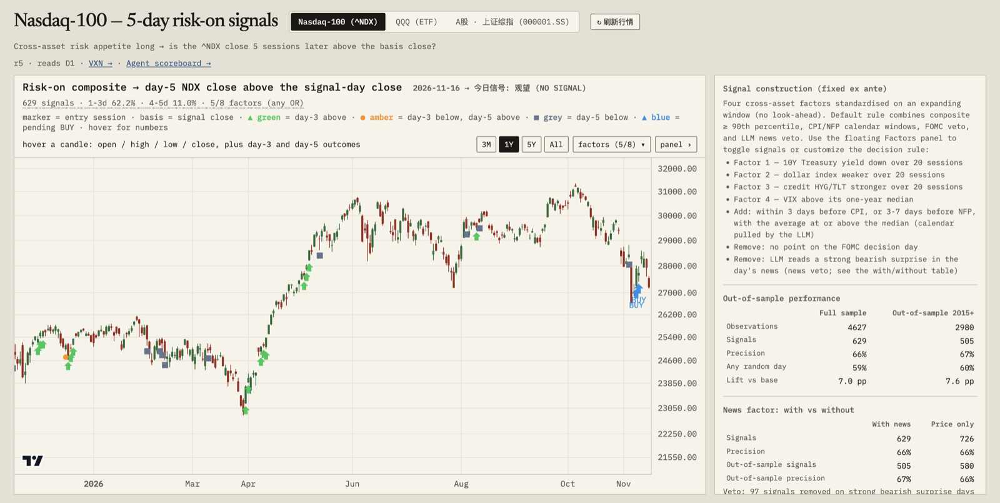

<h1>harukas</h1>

<b>graphics · webgl · 3d tooling · forecasting</b> &nbsp;·&nbsp; 

  

  

  

---

<h2 align="center">forecast-log</h2>

  <b>A point-in-time forecasting system that locks a probability before the outcome is knowable, then scores itself against reality.</b> 
  <a href="https://forecast.lumixraku.org"><b>forecast.lumixraku.org</b></a> &nbsp;·&nbsp; live demo, no signup

Python · SQLite (4 tables) · Cloudflare Workers + D1 · gated LLM agent harness &nbsp;|&nbsp; <a href="https://github.com/abenoharukas/forecast-log">source</a>

**No look-ahead, by construction.** Every factor is standardized on a strictly recursive expanding window using data up to session *t* only. Every tool output, headline and citation passes an `as_of` gate that *raises* on post-cutoff data instead of silently clipping rows.

**Measured, not asserted.** 629 signals since 2002 — **66% precision** against 59% for a random day (**+7.0 pp** lift), **67% out-of-sample** since 2015. Re-settled on the tradable QQQ ETF, the same signal holds at +7.0 pp, with 1.4% flat-call disagreement across 18 years.

**One signal, three markets.** The US close lands at 04:00 Beijing time — hours before the Shanghai open — so the unmodified US signal is mapped onto the next `000001.SS` session: 59.9% precision vs a 53.1% baseline, **+6.8 pp** over 476 signals.

**It grades its own agents.** A framework-free, 8-step tool-using forecasting agent, gated by the same `as_of` check, benchmarked across DeepSeek and Qwen on the *shared intersection* of answered questions and scored with Brier / LogLoss / ECE.

**Ships as a dashboard.** Local no-build server on 4 flat SQLite tables (107k bars · 127k time-gated headlines · 13.7k signals), with a live factor switchboard that recomputes precision and out-of-sample hit rates in the browser — then deploys to Cloudflare Workers + D1.
